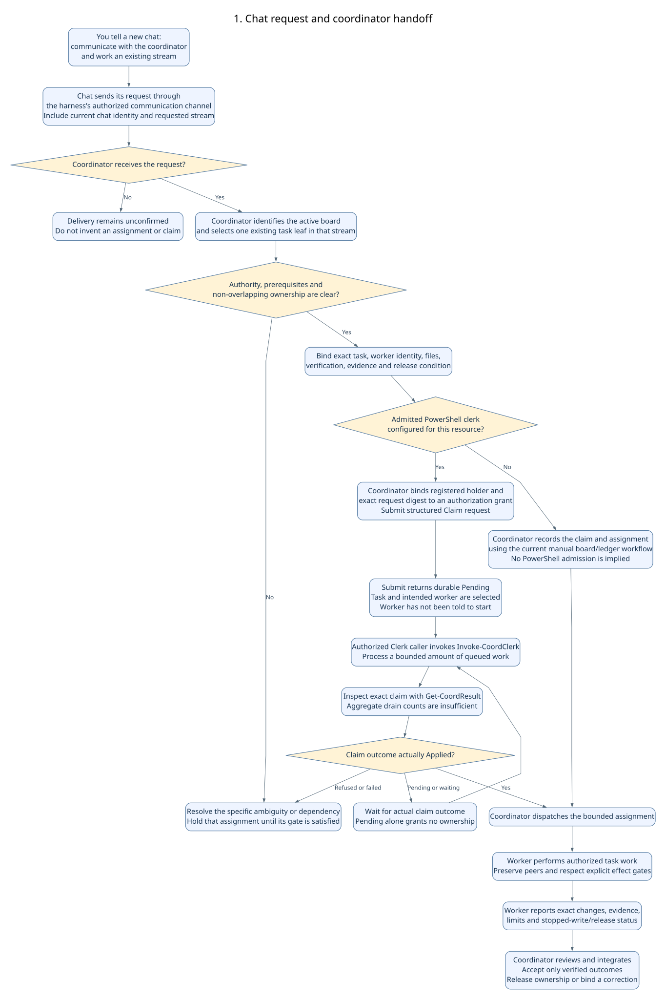
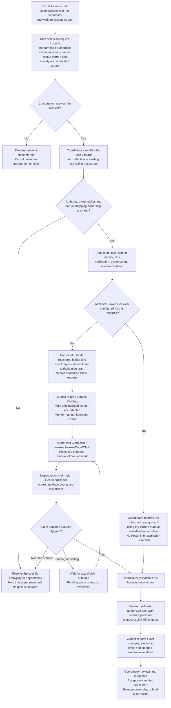
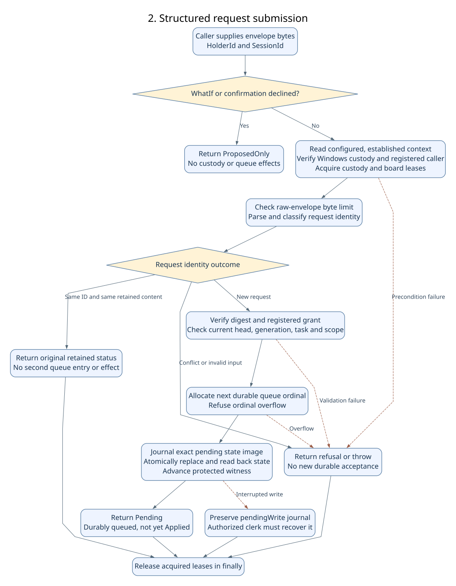
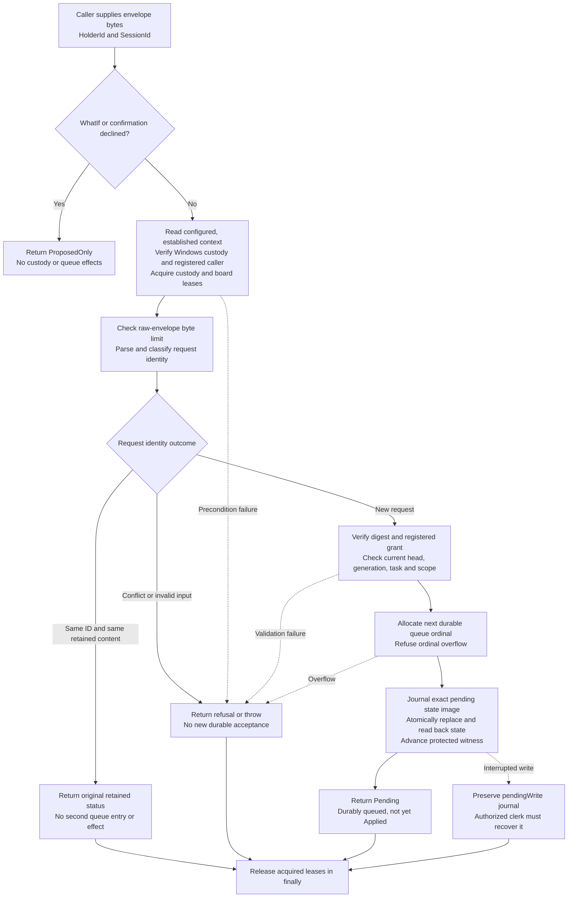
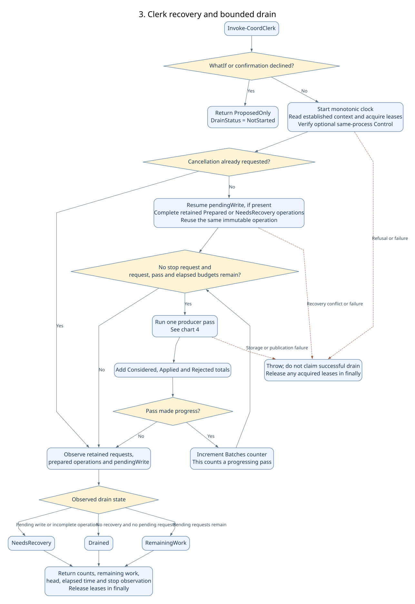
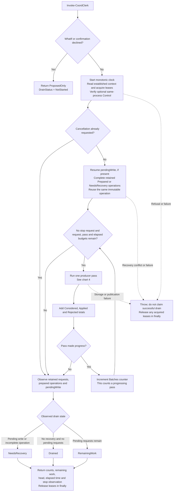
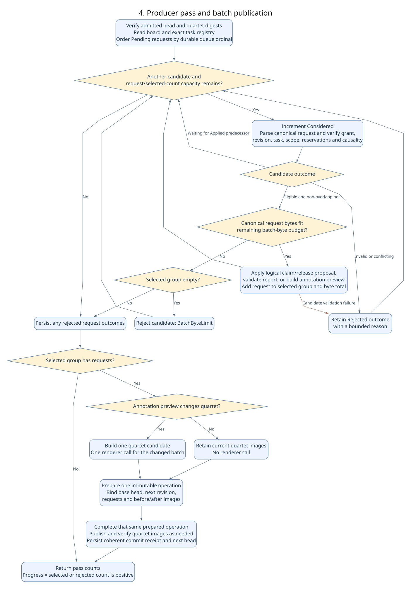
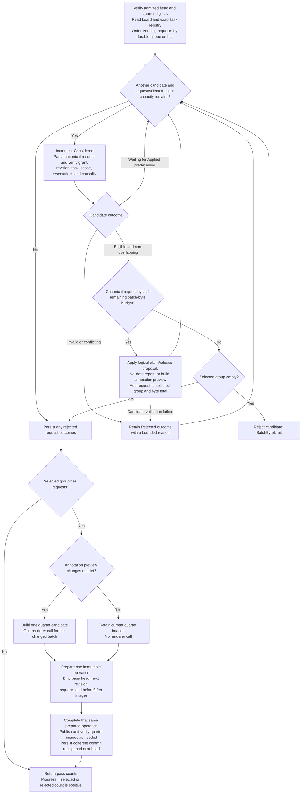

# How the coordination orchestrator works

These flowcharts distinguish the planning coordinator's chat workflow from the
PowerShell source implementation, reviewed on 2026-11-04. They do not establish
installed-package, host-configuration, custody, or live-board admission.
Read [Producer-v1](Producer-v1.md) for those prerequisites
and [Configuration-v1](Configuration-v1.md) for the configuration proposal.

The orchestrator accepts requests about existing sprint tasks, retains them in a
durable queue, and processes eligible requests under one established local owner.
It does not create its own custody, grant itself authority, or run Git operations.

Operational bindings remain separate: B1 requires reviewed configuration and
measured host limits; B2 requires established protected custody and authority;
B3 requires the exact quartet, renderer and lock bindings. The 2026-11-04 UTAT022
profile observation found the eight selected Orchestration mappings/values absent.
The source key registrar is already wired; that does not supply host values or
establish custody.

The charts show production source calls, not mocked test behavior. Unit fixtures
can replace custody, batch or publication boundaries. Passing such fixtures does
not prove actual admission, persistence, renderer cost or live-board readiness.

## 1. A chat asks to work a stream

Suppose you start a chat in Codex, Claude, or another harness and say:
"Communicate with the orchestrator and work Stream C on the current task board."
That is a natural-language instruction to the **planning-board coordinator chat**,
not yet an executable PowerShell request.

The planning coordinator interprets the instruction, chooses and assigns bounded
work, and owns board integration. The PowerShell module is a deterministic
coordination clerk for structured requests. It neither reads arbitrary chats nor
turns free-form text into tasks, grants, or claims.



<details>
<summary>Editable Mermaid source</summary>



</details>

The handoff has several concrete boundaries:

1. **Delivery:** the chat uses an available, authorized channel. In Codex that can
   be a message to the existing coordinator chat; cross-harness coordination may
   use an agreed mailbox or bridge. Saying a coordinator's name does not itself
   deliver a message. No automatic cross-harness listener is implemented by this
   PowerShell module.
2. **Scope:** a stream is a group of tasks, not one executable request. The
   coordinator reads the active board, checks dependencies and competing claims,
   then binds one existing leaf and exact files. A parent milestone does not
   silently authorize every task or new out-of-scope work.
3. **Identity and authority:** the current chat ID and harness identify a
   cooperative worker. They are not an authenticated Windows identity and do
   not confer a role merely because the chat calls itself an orchestrator.
   PowerShell consumption additionally needs established custody, registered
   actors and an exact digest-bound grant. Those records are not created
   automatically by a new chat request.
4. **Ownership:** in the current manual workflow the coordinator records the
   claim before dispatch. In an admitted clerk workflow a structured `Claim`
   must actually become `Applied`; queue acceptance alone is insufficient.
   Registered workers cannot independently take coordinator claim/acceptance
   authority. A coordinator can submit a claim for a registered worker.
5. **Execution:** the worker, not the PowerShell clerk, writes the code or
   documentation and performs the task's authorized verification. The clerk
   coordinates task records; it does not run arbitrary task instructions or
   launch AI harnesses. Existing human authority covers bounded work, while
   real SQL, deployment or other separately gated effects retain their actual
   approval requirements.
6. **Closeout:** the worker supplies a handoff and evidence. The coordinator
   reviews the result, integrates approved changes and releases ownership.
   In an admitted clerk workflow the corresponding records can use
   `ReportResult`, supported `AcceptChange`, and `Release` requests. The current
   `AcceptChange` implementation supports annotations, not arbitrary board
   checkbox/status edits or proof that an entire feature is deployed.

For the configuration observation above, live PowerShell admission has not been
established. A coordinator can continue authorized manual planning and assignment;
that does not make a clerk request configured or its custody valid. This chart's
chat-handling layer describes the coordinator workflow, not a new automatic
dispatcher implemented in the module.

### Exactly what the coordinator sends

After selecting one existing leaf, an admitted coordinator submits a UTF-8 JSON
envelope to `Submit-CoordRequest`. The following is a field-complete **template**,
not an authorized request or a calculated digest. Replace the angle-bracket
placeholders with registered identities and the observed current head; calculate
the lowercase SHA-256 of the canonical request object before submission.

```json
{
  "request": {
    "protocolVersion": "Coordination-v1",
    "resourceId": "<registered-board-resource>",
    "sprintId": "0017",
    "requestId": "<new-resource-lifetime-unique-request-id>",
    "category": "Claim",
    "taskId": "17.30.a",
    "scope": [
      {
        "registeredRootId": "<registered-repository-root>",
        "path": "<exact-owned-relative-path>"
      }
    ],
    "holder": {
      "holderId": "<registered-worker-holder>",
      "sessionId": "<current-worker-chat-session>"
    },
    "authorizationReference": "<registered-exact-request-grant>",
    "generation": "<observed-current-generation>",
    "expectedRevision": "<observed-current-revision>",
    "predecessors": [],
    "payload": {}
  },
  "digest": "<64-lowercase-hex-characters-calculated-from-canonical-request>"
}
```

The `Claim` payload is deliberately empty: task, worker and scope already occupy
mandatory common fields. The claim ID comes from the registered authorization
grant, not a new field invented in this payload. Multiple exact scope entries are
allowed when the bounded assignment owns multiple paths.

The invocation separately identifies the **submitting coordinator**, while the
request's nested `holder` identifies the **worker receiving ownership**:

```powershell
Submit-CoordRequest -EnvelopeBytes $utf8EnvelopeBytes `
  -HolderId $registeredCoordinatorHolder -SessionId $currentCoordinatorSession
```

The protected custody registry must already contain the worker and a grant
matching `authorizationReference`, request ID and canonical digest. A string
claiming authorization does not create that grant. This is a structured ownership
request, not the work instructions; the later chat dispatch carries those.

### What comes back, and who dispatches

There is no single automatic chat-to-clerk-to-worker response. These are separate
calls and decisions:

| Stage | Actual return or observation | Coordinator action |
| --- | --- | --- |
| Submit new claim | `Status=Pending`, `Decision=Queued`, `Durable=true`, string `QueueOrdinal`, and retained `Record`. | Keep the request ID; do not dispatch on queue acceptance alone. |
| Retry same retained request | `Decision=Retained`, original retained `Status`, `Durable=true`, and retained `Record`. | Use that same request's existing outcome; do not mint a second claim. |
| Run clerk | `Status=Observed`, `Applied`, `Rejected`, `Considered`, `Batches`, `Remaining`, `DrainStatus`, `ExitReason`, `StopObserved`, `RecordedHead`, `ElapsedMilliseconds`, and `ResourceId`. | Treat this as aggregate drain information, not a claim-specific success receipt. |
| Query exact claim request | Authorized `Get-CoordResult` returns `Outcome`, `RetainedStatus`, `Record`, linked `Operation`/`CommitReceipt`, and recorded-head/integrity context. | Match the exact request/holder/scope and retained outcome; aggregate `Applied > 0` is insufficient. |
| Exact claim is Applied | Ownership is retained for that registered worker and scope. | Coordinator sends the bounded work assignment to the subordinate chat using its harness channel. |
| Claim pending, rejected or recovery incomplete | No new claim-specific ownership is established for dispatch by that result. | Wait, resolve the exact refusal/recovery gate, or bind another authorized task. |

`Get-CoordResult` is a local read-only projection. Its caller must first establish
permission, authentic custody/lineage and containment; the getter itself does not
authenticate the caller or prove current quartet health. A historical `Applied`
result does not override a later admission hold or stale assignment.

**The coordinator chat dispatches. The PowerShell clerk does not.** The dispatch
names the task, exact files, prerequisites, verification, evidence location,
release condition and exclusions. Starting a brand-new subordinate chat is not
implicit in this module: the coordinator uses an available authorized chat or a
separately authorized dispatch mechanism. The current manual board/ledger route
also dispatches only after the coordinator has established ownership there.

### Is the clerk recording an assignment, or deciding who works?

The coordinator selects the task and intended worker **before submission**. That
selection is a proposed assignment; it is not yet permission for the worker to
start. In the admitted clerk route, the sequence is:

1. Coordinator selects task T, worker W and the exact owned scope.
2. Coordinator calls `Submit-CoordRequest` with a structured `Claim` for T/W.
3. Submission persists the request as `Pending`.
4. An authorized caller registered in the Clerk role invokes `Invoke-CoordClerk`.
   The clerk validates eligibility and conflicts, then applies or rejects work
   within its configured drain limits.
5. Coordinator checks the exact retained claim outcome. Only an applicable
   `Applied` claim establishes ownership for that assignment.
6. Coordinator sends W the work instructions through the harness channel.

Several submissions can precede one drain invocation, but this is not required.
`Submit-CoordRequest` does not trigger a drain. `Invoke-CoordClerk` runs a bounded
drain and returns; it does not remain alive waiting for future submissions. These
functions do not install a timer, scheduler or periodic polling loop. Invocation
timing belongs to the caller or a separately configured runner. The submitting
Coordinator role and draining Clerk role have distinct registered authority;
the coordinator chat must use an appropriately registered caller to run the drain.

The clerk therefore does more than log an already-effective claim: it validates
and durably applies or rejects the proposed state change. It does not choose a
worker, send work instructions or run the worker's task. In the current manual
route, the coordinator instead establishes ownership in the board/ledger before
dispatch; the unadmitted clerk is not retrospectively asserting that ownership.

## 2. Submit a structured PowerShell request



<details>
<summary>Editable Mermaid source</summary>



</details>

`Pending` acknowledges queue persistence. It does not grant a claim, publish a
change, or prove that the requested work is complete. A submitter cannot bypass
an unfinished protected write: the clerk's recovery route handles that condition.
Retrying a retained request uses the same ID and content; changing retained
content is an identity conflict. Recovery completes the same recorded operation
rather than manufacturing a new request, revision or publication plan.

## 3. Run the clerk and drain bounded work



<details>
<summary>Editable Mermaid source</summary>



</details>

Recovery happens before new batch selection. It does not consume the new-loop
`Batches` counter, although its elapsed time is included in the stopwatch.
Cancellation is checked before recovery and between passes; it does not interrupt
an already executing publication at an arbitrary instruction.

The millisecond budget is a safe-boundary admission limit, not a hard completion
deadline. A running pass or recovery can finish after that elapsed budget.

## 4. What happens during one producer pass



<details>
<summary>Editable Mermaid source</summary>



</details>

Only requests whose predecessors were already `Applied` can join a batch.
The implementation does not collapse a causal chain into one batch. Compatible,
independent requests can share one base revision and one next revision.

A candidate that cannot fit after earlier selections stays pending at that point.
It is not implicitly rebased: later validation still checks its original expected
revision. A later overlapping candidate is rejected, rather than silently moved
to another batch. See the [coordination contract](Coordination-v1.md).

The four output files are the Markdown board, board HTML, procedural-details HTML,
and accomplished HTML. Publication is not a single atomic replacement of all four
files. The retained immutable plan and coherent receipt let recovery distinguish
an incomplete publication from a committed next head. Unexpected third-state
output bytes hold recovery; they do not authorize a replacement plan.

## Passes, batches and counters

| Term or counter | Meaning in the current implementation |
| --- | --- |
| Pass | One call to `Invoke-CoordProducerBatch`, examining pending candidates. |
| Selected batch | Eligible, compatible requests selected for one prepared operation. |
| `Considered` | Candidate visits, including rejected and waiting candidates. A still-pending request can be visited again in another pass. |
| `Batches` | Passes with `Progress = true`, including rejection-only passes. A final no-progress pass is not counted. |
| Prepared operations | Selected batches retained for coherent completion; rejection-only passes do not prepare a new operation or advance the revision. |
| Renderer calls | One per changed annotation batch; unchanged quartet batches render zero times. |

For example, a pass selecting A and B increments `Batches` and prepares one
operation. A second pass rejecting C also increments `Batches`, but prepares no
operation. A third pass finding nothing actionable stops without incrementing it.

These are implementation observations. They do not ratify the still-proposed
configuration accounting or select host operating limits.

## Envelope versus request object

```text
Submitted envelope
  request    The action: resource, task, holder, scope, revision, payload, etc.
  digest     SHA-256 of the canonical request object only
  transport  Optional delivery metadata
```

| Budget | What is counted | What is not established by it |
| --- | --- | --- |
| `MaxRequestBytes` | Raw UTF-8 envelope bytes before parsing. | Peak memory, queue capacity or rendered output size. |
| `MaxBatchBytes` | Sum of canonical request-object bytes for selected requests. | Envelope overhead, rejected requests, journal/prepared images or quartet file sizes. |
| `MaxBatchRequests` | Selected request count within one pass. | Total considered visits or rejected candidates. |
| `MaxDrainRequests` | Considered candidate visits across this invocation. | Unique request count or successful application count. |
| `MaxDrainBatches` | Progressing passes across this invocation. | Prepared-operation count or renderer-call count. |
| `MaxDrainMilliseconds` | Monotonic elapsed time checked before another pass. | A preemptive timeout or guaranteed total completion time. |

Adding JSON formatting whitespace can increase envelope bytes while leaving the
canonical request and digest unchanged. Changing a value inside the request can
change both its canonical bytes and its digest.

## Stop, query and export boundaries

`Stop-CoordClerk` requests cancellation through the borrowed same-process control.
A stop request is not proof of completed drain or released custody. Inspect the
clerk's actual result and retained state.

The query commands report retained tasks, claims and request outcomes. An
`Export-CoordState` call separately acquires authorized custody and writes exact
state, witness and observed quartet bytes to a fresh protected backup file.
Export does not authorize restore, re-bootstrap or a new lineage.

## Source references

- [Submit-CoordRequest](../public/Submit-CoordRequest.ps1)
- [Invoke-CoordClerk](../public/Invoke-CoordClerk.ps1)
- [Configuration, custody and state journal helpers](../private/CoordProducer.ps1)
- [Batch selection and request effects](../private/Invoke-CoordProducerBatch.ps1)
- [Recovery and operation construction](../private/CoordClerkProducer.ps1)
- [Canonical request parser](../private/ConvertTo-CoordCanonicalRequest.ps1)
- [Save prepared operation](../private/Save-CoordOperation.ps1)
- [Complete prepared operation](../private/Complete-CoordOperation.ps1)
- [Quartet candidate and renderer boundary](../private/New-CoordQuartetCandidate.ps1)
- [Export-CoordState](../public/Export-CoordState.ps1)
- [Exact retained result projection](Get-CoordResult.md)
- [Request envelope and category schema](../schemas/request-v1.schema.json)

